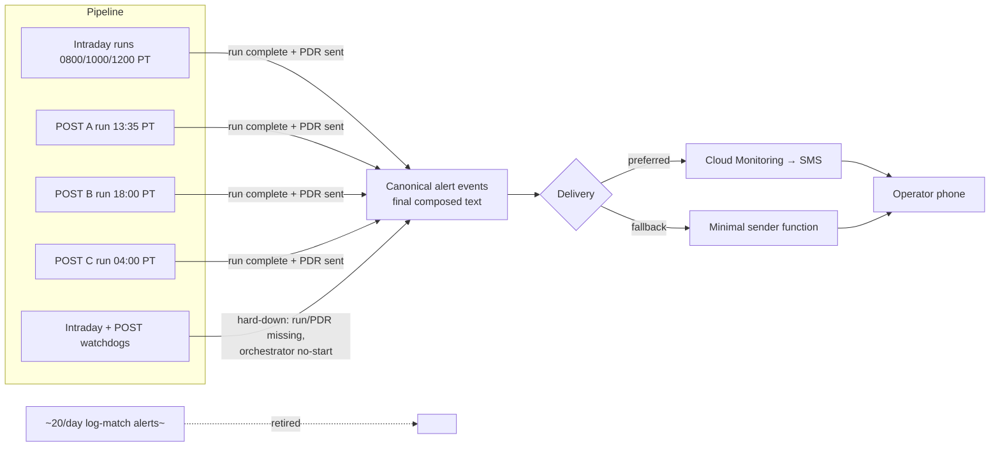

**Topic:** Ops SMS Alerts  
**Topic Slug:** ops-sms-alerts  
**Thread:** Pipeline SMS Refresh  
**Thread Slug:** pipeline-sms-refresh  
**Issue:** #200  
**Thread Parent:** #199  
**Topic Parent:** #198  
**Domain:** OPS  
**Type:** PRD  
**Status:** Approved  
**Created:** 2026-10-17  
**Last Updated:** 2026-10-17  

# PRD: Pipeline SMS Refresh

## Problem Statement

The operator receives approximately 20 SMS/text messages per day generated by data-pipeline events. The messages are poorly written, hard to decipher, and do not carry the information needed to understand pipeline state at a glance. Root cause: there is no in-repo message layer — pipeline code emits raw log lines and Google Cloud Monitoring alert policies turn them into texts, so message wording is effectively an auto-generated log dump that lives outside the codebase (unversioned, untestable).

## Solution

Replace **all** current pipeline SMS alerts with a small, fixed set of human-composed messages:

- **4 routine "signoff" texts per trading day** — each fires when a run's work is fully done (last interval complete, PDR published), and summarizes that run in plain English.
- **Hard-down exception texts** — only when a run is missing entirely, a PDR was never sent, or an orchestrator never started. Partial failures never trigger their own text; they are surfaced inside the signoff text's counts.
- **Message text is composed in this repo** as ordinary, versioned, unit-testable code. The existing Cloud Monitoring → SMS path delivers it if the channel can carry composed text (verification item); otherwise a minimal dedicated sender is the last hop. Either way, composition is the same.

## User Stories

1. As the operator, I want no more than 4 routine texts on a normal trading day, so that the cadence is predictable and silence is meaningful.
2. As the operator, I want a signoff text when the intraday 0800 PT run completes (all jobs finished, PDR sent), so that I know the first market-hours refresh shipped successfully.
3. As the operator, I want the same signoff text for the intraday 1000 PT and 1200 PT runs, so that each market-hours tick is confirmed.
4. As the operator, I want a signoff text when the POST A run's last interval (DAILY/WEEKLY/MONTHLY) completes and its PDR is sent, so that the text truthfully covers all three intervals as "our work is done for that run."
5. As the operator, I want each signoff text to show the run identity, market date, per-interval symbol counts (succeeded/created), failure count, PDR confirmation, and duration — in verbose readable prose (~2 SMS segments) — so that no decoding is required.
6. As the operator, I want failed symbols shown as counts in the text and listed by name in the logs and run doc (`nonSuccessJobs`), so that the text stays short while detail remains one query away.
7. As the operator, I want a text only for hard-down conditions — run doc missing, PDR missing, orchestrator never started — so that an SMS always means something needs attention.
8. As the operator, I want hard-down coverage extended to the B (18:00 PT) and C (04:00 PT) POST passes, which today have no watchdog, so that silent retry-pass failures can't hide.
9. As the operator, I want exception texts to state what was expected, what actually happened, which run/pass/interval, and where to look next, so that I can act without triaging blind.
10. As the operator, I want zero texts on market-closed days (weekends, holidays), so that silence then means "nothing expected," not "something broke." This requires the POST watchdog to gain the calendar gating the intraday watchdog already has.
11. As the operator, I want each signoff/exception text sent exactly once per run even if schedulers redeliver, so that I never see duplicate texts.
12. As the operator, I want every pre-existing pipeline SMS alert retired, so that old and new messages never double-fire.
13. As the maintainer, I want the message text produced by pure, unit-testable formatting code in this repo, so that message wording is reviewed in PRs and cannot drift.
14. As the maintainer, I want a single composition seam — one canonical "alert event" carrying the final formatted text — so that the delivery mechanism can change without touching message content.
15. As the maintainer, I want trigger detection to reuse the existing run-completion/PDR-publish code paths and watchdog pattern, so that alerting stays consistent with how pipeline state is already computed.
16. As the operator, I want the B and C retry passes to produce no routine texts (exceptions only), so that the daily rhythm is: intraday ×3, POST ×1, plus anything broken.

### Acceptance Criteria

- On a clean trading day, the operator receives exactly 4 texts: intraday 0800, intraday 1000, intraday 1200, POST A.
- Each signoff text arrives only after the run's final interval is complete and its PDR publish succeeded — verified against `realtime-runs`/`intraday-runs` doc state.
- A market holiday produces zero texts and zero false alarms.
- Simulated run-missing, PDR-missing, and orchestrator-no-start conditions each produce exactly one exception text naming the affected run.
- A B or C pass that never runs produces an exception text at its watchdog window (currently uncovered).
- No current alert fires after cutover — the ~20/day messages are fully replaced.

## Technical Context

- **Schedules (PT):** intraday ticks 0800/1000/1200 (watchdogs at +15min); POST passes A 13:35, B 18:00, C 04:00 (next day). All weekday-only; market holidays apply.
- **SMS budget:** ~160 chars/segment; target ≤2 segments (~300 chars).
- **Run docs** (`realtime-runs`, `intraday-runs`) carry `createdJobs`/`finishedJobs`/`successJobs`/`permanentFailureJobs`, `partnerDataReady.messageSent`, and `nonSuccessJobs` (first ~100 failed symbols). Run docs are deleted after ~2 days by nightly cleanup — signoff content must be self-contained.
- **Verification item:** whether GCP alert notifications can carry a composed text field verbatim into the SMS body is unconfirmed — must be verified before choosing the delivery mechanism.
- **Existing detection:** intraday watchdog covers run_missing/pdr_missing for all 3 ticks; post watchdog covers **A only** (B/C coverage is new work).

## System Context

## Implementation Decisions

- **Canonical alert event:** a single in-repo abstraction emits "alert events" carrying the fully composed SMS text (e.g. an `sms_text` field). Trigger sites and formatters are separate from delivery.
- **Message composer:** pure functions mapping run/health state → final text. Verbose readable style, plain-English, no abbreviations requiring a legend.
- **Signoff triggers:** reuse the existing run-completion aggregation path (where `partnerDataReady.messageSent` is set / PDR is published) as the emission point — one per intraday run, one per POST A run (after last interval).
- **Exception triggers:** reuse the watchdog pattern. Extend POST watchdog coverage to B and C passes; add calendar gating to the POST watchdog for parity with intraday.
- **Idempotent send:** a send-once marker on the run doc (mirroring `partnerDataReady.messageSent`) prevents duplicate texts on scheduler redelivery.
- **Delivery seam:** emit the composed text to the alerting path. Preferred: existing Cloud Monitoring → SMS forwards composed text (pending verification). Fallback: a minimal sender function consuming the same alert events. Composition is identical on both paths.
- **Decommission:** all existing pipeline log-match/SMS alert policies are retired as part of this work — full replacement, not augmentation.
- **No changes** to PDR payloads, the partner contract, or run/health doc schemas (additive fields only, e.g. the send-once marker).

## Testing Decisions

- **Seams:** message formatter pure functions (lowest seam — input run doc shape, output string) and trigger detection (aggregator-level). No new seams beyond the alert-event emission point.
- **Good tests assert external behavior:** given a completed run state → exact text string produced; given a missing run at watchdog time → exception text produced once.
- **Modules under test:** the composer (all four message types + exception variants), the send-once/idempotency guard, the B/C watchdog extension, and the calendar gate.
- **Prior art:** `functions/tests/` Jest suite (e.g. `post-all-intervals-orchestrator.test.ts`) for orchestration-level behavior with mocked Firestore.

## Out of Scope

- The Run Status Dashboard (Topic #61) and health-doc consumption — health docs continue to be written unchanged.
- Additional channels (Slack, email, push) — architecture permits later, not built now.
- Partner-facing changes to PDR message content.
- Rate-limiting/dedup infrastructure beyond per-run send-once markers.
- Alerting for non-pipeline domains (Benzinga, options corpus, etc.) unless already on the same log-match policies being retired.

## Further Notes

- The composition-vs-delivery seam decision is a candidate for a lightweight ADR at blueprint time if the GCP delivery verification forces the fallback sender.
- Blueprint must include an inventory of existing alert policies to retire, and the GCP-verification spike (can a notification channel carry composed text?).
- A good signoff has one job: let the operator confirm "work is done for that run" without opening any console.
