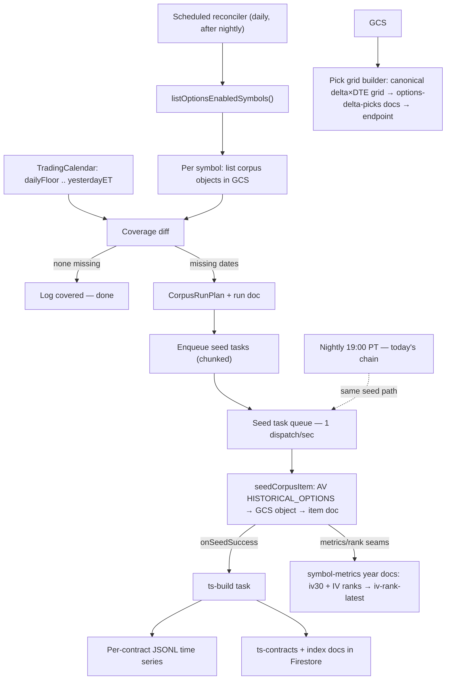

**Topic:** Options Corpus Bulk Ingest  
**Topic Slug:** options-corpus-bulk-ingest  
**Thread:** Full-Date Corpus Backfill (2026)  
**Thread Slug:** full-date-backfill-2026  
**Issue:** #215  
**Thread Parent:** #214  
**Topic Parent:** #213  
**Domain:** OPTIONS-DATA  
**Type:** PRD  
**Status:** Approved  
**Created:** 2026-10-24  
**Last Updated:** 2026-10-25  

# PRD: Daily Calendar Coverage for the Options Corpus

## Problem Statement

The options corpus exists to feed backtesting (spread/strategy analysis over contract time series), but its coverage is **sparse by design**: the Raw Corpus contains only swing-pivot dates plus the nightly chain fetches since each symbol was enabled (~2026-09-27). For the options-enabled universe — **129 symbols** at authoring time (verified 2026-10-24: 129 enabled / 925 tracked / 909 optionable) — the vast majority of trading days between **2026-01-01** and the enable date have no chain snapshot — so contract Time Series and their `ts-contracts` catalog docs are incomplete for backtesting.

Filling those gaps today is a manual procedure (tranched calls to the pilot backfill endpoint). That approach does not scale toward the ~250-symbol ceiling the operator anticipates: every new symbol would need another manual, babysat run. The `optionsEnabled` flag is already the curated opt-in — only ~1 in 5 symbols merits options coverage, and the flag is only set on those — so the reconciler keys off it directly with no parallel flag.

## Solution

Make **daily coverage a maintained invariant**, not a one-off job:

> For every options-enabled symbol, a Raw Corpus object must exist for every trading day in `[daily coverage floor .. latest completed trading day]`.

A scheduled **calendar-coverage reconciler** — a sibling of the existing pivot-seed fanout — iterates the options-enabled universe (`optionsEnabled` *is* the opt-in: the flag is only ever set on symbols curated for options trading), lists each symbol's stored corpus objects, diffs against the trading calendar, and enqueues one seed task per missing date. Everything downstream is unchanged: the seed worker fetches `HISTORICAL_OPTIONS` from Alpha Vantage, writes the Raw Corpus object, and the existing seed→ts-build fanout produces the per-contract Time Series JSONL and `ts-contracts` Firestore docs.

The same mechanism serves three needs with zero per-batch work:

- **The initial backfill** — the reconciler simply finds ~190 missing dates per symbol today.
- **Ongoing daily freshness** — each trading day, yesterday's date enters the expected set; a missing or failed nightly fetch is detected and healed automatically.
- **Curated growth** — enabling a symbol is itself the opt-in; the next reconcile drains its gaps. Since `optionsEnabled` is only set on deliberately curated symbols, no additional consent step exists.

## User Stories

1. As an **options backtester**, I want a Raw Corpus chain snapshot for every trading day since 2026-01-01 for every options-enabled symbol, so that contract price queries over that window never hit coverage gaps.
   - **Acceptance:** A per-symbol coverage audit (expected trading days vs. stored corpus objects) reports zero missing dates for every enabled symbol in `[2026-01-01, latest completed trading day]`.
2. As an **options backtester**, I want a `ts-contracts` Firestore doc and per-contract JSONL Time Series for every contract observed in the window, so that I can pull a contract's full price/Greeks history.
   - **Acceptance:** For a spot-checked symbol (SPY), `options-file-index/SPY/ts-contracts` docs exist for contracts observed in the window, and their `firstObserved`/`lastObserved`/`observationCount` reflect the newly built dates.
3. As an **operator**, I want the backfill to run unattended at provider-safe rates, so that I don't babysit ~24,000 API calls.
   - **Acceptance:** The initial drain proceeds at the seed queue's 1 dispatch/sec ceiling with no manual intervention; transient failures retry to terminal `success`/`permanent_failure` states visible in `options_corpus_runs` item docs.
4. As an **operator**, I want daily freshness guaranteed by the coverage invariant, so that a missed or failed nightly fetch self-heals without intervention.
   - **Acceptance:** If a trading day's corpus object is absent after the nightly run, the next reconcile detects it as missing and enqueues a seed task for it.
5. As an **operator**, I want `optionsEnabled` itself to be the coverage opt-in — no parallel flag — so that the existing curation flow is the only gate, and enabling a curated symbol is the *only* action needed for its gaps to drain on the next reconcile.
   - **Acceptance:** The reconciler's universe is exactly `optionsEnabled === true` (currently the 129 pivot-corpus symbols — verified 2026-10-24); a newly enabled symbol's missing dates are enqueued automatically on the next pass; disabling the flag stops planning at the next pass.
6. As an **operator**, I want the reconciler to be idempotent, so that re-runs and overlapping producers (nightly, pivot fanout) never duplicate spend.
   - **Acceptance:** A reconcile immediately following a fully-covered window enqueues zero seed tasks and makes zero AV calls; objects already stored by any producer count as covered.
7. As an **operator**, I want reconcile activity tracked as corpus runs, so that I can audit what was dispatched and what completed.
   - **Acceptance:** Each reconcile that dispatches work creates an `options_corpus_runs` doc with per-item outcomes (`success`, `skipped`, `failure`, `permanent_failure`), matching the existing run-tracking shape.
8. As an **operator**, I want per-symbol coverage reporting in reconcile logs, so that I can see planned/covered/missing counts before and after a drain.
   - **Acceptance:** Each per-symbol reconcile logs `{symbol, planned, covered, missing, enqueued}`; a reconcile with nothing to do logs that explicitly.
9. As an **operator**, I want the daily coverage floor to be independent of the 2019 pivot corpus floor, so that daily density never demands ~1,750 days/symbol of backfill.
   - **Acceptance:** The expected date set never extends before 2026-01-01; pre-2026 objects (pivot provenance) are neither required nor deleted by the calendar reconciler.
9a. As an **options backtester**, I want a per-symbol IV time series — `iv30` (plus method and contract-count quality fields) written per trading day into `symbol-metrics/{SYM}/years/{YYYY}` during ingestion — so that looking up "the IV for a symbol on a date" never requires re-deriving it from raw chains.
    - **Acceptance:** For every covered trading day where inputs exist (corpus object + `sa-time-series` adjusted close), the symbol's year-shard `days` map carries an `iv30` entry; a missing-day means a documented skip (no corpus or no close bar), never a fabricated value.
9b. As an **options backtester**, I want the IV-rank fields (`ivRank30/60/180/360`, `ivPct…`, `ivN…`) refreshed as the series densifies, so that rank context is available alongside raw IV.
    - **Acceptance:** Newest-day rank fields and the `iv-rank-latest/{SYM}` doc reflect the full trailing IV30 series; historical-day ranks are computed at seed time against available history (documented approximation, not revisited).
9c. As an **options backtester**, I want every contract-day observation to retain the greeks AV supplies (`delta`, `implied_volatility`, `gamma`, `theta`, `vega`, `rho`), so that delta-based strike selection (e.g. "the 20-delta put at ~45 DTE") for a cash-secured-put backtest is a direct lookup over the day's chain — no Black-Scholes inversion, no symbol-level-IV approximation.
    - **Acceptance:** Each stored per-contract observation (GCS JSONL + `partnerHistoricalOptionsV2` wire shape) includes `delta` and `implied_volatility` alongside bid/ask/mark/volume/OI for every covered date; no extra computation is added to ingestion.
9d. As an **options backtester** (SavantTrader engine), I want a canonical delta/DTE pick grid **eagerly materialized** per options-enabled symbol — a fixed param space (e.g. ~19 delta levels × ~10 DTE targets × put/call) computed once per covered date — so that the pick docs are a standing dataset every backtest run reads directly, with zero per-run compute.
    - **Acceptance:** Per (date, delta-level, DTE-level, type) cell: `argmin |observedDelta − targetDelta|` over the day's chain filtered by type + expiry criteria; each chain is loaded once per (symbol, date) regardless of cell count — the grid dimension adds no extra I/O; picks store `contractId`, `strike`, `expiration`, `observedDelta`, `iv`, `mark`; always real listed strikes; cells on dates with no chain carry an explicit miss. Every day entry (pick or miss) also carries `underlyingClose` — the `sa-time-series` split-adjusted close for (symbol, date), joined the same way `MetricBuildService` does — so a backtest always has spot for the entry day.
9e. As an **options backtester**, I want the pick grid persisted in per-(symbol, type, delta, DTE) **year-sharded** docs holding a date→pick map — never one giant per-symbol doc (a dense grid over ~250 days exceeds the 1 MB doc limit; year shards match the `symbol-metrics` convention) — so that a backtest pulls exactly the cells it trades, reads stay small, and each new year just starts a new shard.
    - **Acceptance:** `options-delta-picks/{SYM}_{type}_{delta}_{dte}/years/{YYYY}`-style docs (~190 cells/symbol/year, ~tens of KB each); safe because the historical corpus is immutable — written once, never invalidated; each trading day appends one `days.{date}` entry per cell via the nightly path; `no_chain` entries self-repair when the corpus gap heals; the cell doc is the unit of work — adding a grid delta/DTE level materializes only new cell docs and never rewrites existing ones.
9g. As an **operator**, I want grid materialization fanned out through Cloud Tasks (per symbol or per symbol×date-chunk) rather than a monolithic job, so that initial materialization for ~130 symbols × ~200 days runs in hours, is resumable, and needs zero AV calls (pure GCS reads + Firestore writes).
    - **Acceptance:** Backfill tasks read chains from GCS only; per-symbol failure isolation and item-level retry like the seed worker; the same code path serves nightly appends and on-demand off-grid compute (9f).
9f. As an **options backtester**, I want a partner-style HTTP endpoint that serves grid picks (and can compute on-demand for off-grid params: arbitrary delta/DTE/symbol/date combos not in the canonical grid), so that unusual backtests still work without widening the standing grid.
    - **Acceptance:** In-grid queries are served from stored docs; off-grid queries compute the same `argmin` selection on demand over the day's chain (optionally persisting the result); response carries `contractId`, `strike`, `expiration`, `observedDelta`, `iv`, `mark` per (date, combo) with explicit misses.
10. As an **operator**, I want non-trading days and disabled symbols excluded from every plan, so that no AV spend is wasted.
    - **Acceptance:** Planned dates come only from the trading calendar; a symbol whose `optionsEnabled` flag is cleared mid-run produces `skipped` item outcomes and zero further AV calls.
10a. As an **operator**, I want the seed→ts-build fanout to never silently drop a new date's build *(production bug, verified 2026-10-24)*, so that per-contract series stay current even while long range builds hold a symbol's lease. **DELIVERED 2026-10-25.**
    - **Context:** `corpus-seed.task.ts` `onSeedSuccess` skipped the ts-build enqueue whenever `isTsBuildLeaseHeld` — assuming the in-flight range build covered the date. A Sept-drain range build ending 2026-09-26 starved every post-9/26 date for QQQ: chains landed nightly, series frozen at 9/25.
    - **Acceptance — verified:** lease docs now record `coveredUntil` (build endDate); `onSeedSuccess` skips **only** when `date ≤ coveredUntil` (`leaseCoversDate`/`isTsBuildDateCovered`); legacy lease docs without `coveredUntil` never suppress. Regression test: `tests/v2/historical-options-corpus/ts-build-lease.service.test.ts`. Deployed 2026-10-25.
10b. As an **operator**, I want the two frozen symbols healed to current — QQQ (convoy-drained + range build through latest covered day) and TQQQ (re-enable `optionsEnabled`, seed missing chains from its last chain date, range build through latest) — so that every enabled symbol's series is current. **DELIVERED 2026-10-25.**
    - **Acceptance — verified:** 138-task QQQ zombie convoy purged + stale lease cleared → heal range 9/26→10/23 → `ts-contracts.lastObserved = 2026-10-23` (395k docs; the user-reported `QQQ261106P00713000` now has JSONL + catalog doc). TQQQ re-enabled (`tracked-symbols.optionsEnabled=true` + audit history), 20 missing chains seeded 9/28→10/23, range build 7/31→9/25 completed (40/40 dates, 3,662 contracts), daily builds drained → `lastObserved = 2026-10-23` (71,822 docs). Remaining risk: the broader staleness spot-check across all enabled symbols is a reconcile-time assertion.
10c. As an **operator**, I want suspect corpus objects flagged rather than silently accepted — e.g. a stored chain containing contracts of only one type (verified: 4 QQQ dates in 2026 are calls-only, ~5,800 contracts each, zero puts) — so that malformed upstream snapshots surface for re-seed instead of counting as healthy coverage.
    - **Acceptance:** A chain-sanity check (put+call presence, nonzero counts) marks suspect objects in logs/run metadata; the reconciler treats them as gap-eligible for re-seed rather than covered.

## Implementation Decisions

- **No parallel flag** — `optionsEnabled` is the opt-in, deliberately. It is already a curated gate (129 of 925 tracked); enabling a symbol is an explicit operator decision that includes daily coverage. The reconciler's universe = `listOptionsEnabledSymbols()`, identical to the nightly and pivot producers.
- **New constant** `OPTIONS_CORPUS_DAILY_FLOOR_DATE = '2026-01-01'` — the daily coverage floor, deliberately distinct from `OPTIONS_CORPUS_FLOOR_DATE` (`2019-01-01`), which remains the absolute floor for the pivot corpus.
- **Coverage window** — expected set = `TradingCalendarService.getTradingDates(dailyFloor, latestCompletedTradingDay)`, where the end is *yesterday ET* (the most recent fully-closed trading day). Today's chain remains the nightly job's responsibility; this also prevents the reconciler from racing the 19:00 PT nightly on the same date.
- **Calendar-coverage fanout** — a sibling of `fanoutPivotSeeds` with the same dependency-injected shape: list the symbol's corpus objects → diff dates → create a `CorpusRunPlan` → chunked parallel enqueue of `CorpusSeedPayload` tasks onto the existing seed queue. No pivot `kind` stamp — calendar-seeded objects are permanent and invisible to the pivot reconciler's interim-deletion rules, matching nightly/pilot provenance.
- **Scheduling** — a dedicated scheduled function rather than extending `sweepHistoricalOptionsCorpus`, so the per-symbol list+diff+enqueue work for ~129–250 symbols gets its own timeout budget and doesn't contend with the pivot reconcile. Cadence: daily after the nightly job (blueprint to pick the exact slot).
- **Everything downstream is reused unchanged** — seed task queue (1 dispatch/sec, the AV spend governor), `seedCorpusItem` (floor check, optionsEnabled gate, GCS idempotency, retry to terminal states), `onSeedSuccess` ts-build fanout, `ContractCatalogWriter`/`OptionsIndexWriter` for the per-contract docs, metrics/IV-rank seams (status quo for enabled symbols).
- **Symbol IV series rides the drain for free** — the seed task's `metrics` seam (`MetricBuildService` → `SymbolMetricsRepository` → `symbol-metrics/{SYM}/years/{YYYY}` day entries: `iv30`, `iv30Method`, `iv30Contracts`) and `rankMetrics` seam (`RankBuildService` → rank fields + `iv-rank-latest/{SYM}`) already run on every confirmed-present date, including backfill seeds and gcs-hits. No new computation work; the reconciler simply creates the dense input the metric seams need. Prerequisite: the `sa-time-series` adjusted close bar for the date — absent bar → deterministic skip (never a fabricated iv30).
- **No seed worker changes** — 2026-01-01 is already above the absolute floor; the existing optionsEnabled gate covers the curation requirement.
- **Empty-plan safety** — mirror the pivot fanout's early-return: if the expected set is empty (e.g., non-trading-day edge), do nothing and log explicitly.
- **SPY canary** — the first production verification target is SPY (dense chain, exercises the path hardest); verify coverage audit + `ts-contracts` output before the full drain.

## Testing Decisions

- **Highest seam:** the fanout's injected-deps core (same seam as `pivot-seed-fanout.test.ts`) — fake `listObjects`, `calendar`, `createRunPlan`, `enqueueTask`, `listOptionsEnabledSymbols`; assert the diff, plan shape, and enqueue payloads. No GCS/Firestore/AV in unit tests.
- **Cases mirroring the pivot fanout suite:** all-covered → zero enqueues and no run doc; partial coverage → only missing dates enqueued, sorted; empty expected set → early return; per-symbol failure isolated (one symbol's planner/list error doesn't abort the sweep); pre-floor dates never planned; chunked dispatch ordering.
- **Worker-level tests already exist** for `seedCorpusItem` (gate, floor, gcs-hit, retries) — unchanged; the reconciler adds no new worker behavior.
- **Prod verification (canary):** dry-run/report first for SPY showing missing-count; execute; confirm coverage audit zero-missing and `ts-contracts` docs reflect the window. Existing ops runbook queries (`seed.stored`, coverage audit via `gcloud storage ls`) apply.

## Out of Scope

- **Pre-2026 daily density.** The corpus stays sparse-before-2026 by design (pivot dates only). Extending the daily floor earlier is a future, deliberate decision — it multiplies AV spend (~1,750 days × symbol count).
- **Pivot corpus semantics.** Swing-set generation, pivot-date seeding, and interim-snapshot lifecycle are unchanged.
- **Per-symbol coverage floors.** All enabled symbols share the single 2026-01-01 floor (revisit if asymmetric coverage is ever needed).
- **Onboarding machinery.** Tracked-symbol creation and the optionable probe are existing paths; this Thread assumes enabled symbols already pass that gate.
- **Contract-level filtering.** Full chains are stored per date — no strike/DTE/moneyness selection.
- **Deleting or rewriting existing objects.** Covered dates are credited regardless of provenance (pivot, nightly, prior seed); nothing is re-fetched.
- **Realtime/quote endpoints.** This concerns only the historical daily corpus.
- **New IV metrics / series reshaping.** `iv30` + IV-rank fields are the existing contract (`partnerIvMetricsV2` already serves them). Backfilling additional tenors (`iv60`/`iv90`), flattening the year-sharded series into single docs, or recomputing historical-day ranks against full history are all separate work.
- **Precomputed fixed-level delta maps** — stories 9d/9e deliver the *discrete* cut of the same data (real contract per requested delta, lazy-cached); Topic #58 (DELTA-MAPS) is the *interpolated* cut (fixed-grid price levels for contour rendering) and remains a separate visualization product if pursued — the two share the same per-(symbol, date) chain-scan machinery but are not interchangeable: picks return tradable contracts, maps return interpolated levels.
- **Black-Scholes strike derivation** — selection always returns a real listed contract's observed delta; no pricing model is inverted and no synthetic strikes are produced.

## Technical Context

- **Initial drain time:** ~190 missing trading days × ~129 opted-in symbols ≈ ~24,000 AV calls (exact count from the dry-run coverage report). At the seed queue's 1 dispatch/sec ceiling this is ~7+ hours of drain — plan the initial run over a weekend (no new trading days, no nightly contention).
- **Steady-state cost:** ~1 AV call per opted-in symbol per trading day (~129 now, ceiling ~250 — so ~250 calls/day max), shared with the nightly producer — the reconciler typically finds 0 gaps and spends nothing.
- **Universe size (verified 2026-10-24):** 925 tracked / 909 optionable / **129 optionsEnabled**. The reconciler covers exactly the enabled set — growth is controlled by the same curation decision that already governs pivot seeding and nightly fetch.
- **AV rate budget:** seed tasks each make one `HISTORICAL_OPTIONS` call; the 1/sec queue cap keeps this pipeline ≤60 calls/min, under the ~75/min provider limit. Other AV consumers share that budget — transient rate-limit errors self-heal via retry.
- **Storage shape:** Raw Corpus objects are immutable gzipped envelopes; ts-build appends are idempotent merges deduplicated by date — re-running any stage is safe.
- **Concurrency:** the per-symbol ts-build lease serializes builds per symbol; multiple symbols build in parallel.

## Further Notes

- The current enabled universe is exactly **129 symbols** (verified 2026-10-24 via Firestore aggregation: `tracked-symbols` where `optionsEnabled == true`). Anticipated ceiling ~250; growth stays under the same deliberate curation flow.
- Existing monitoring applies: `options_corpus_runs` run/item docs, `seed.stored`/`seed.error` logs, GCS coverage audits in the corpus-backfill runbook.
- The reconcile mechanism subsumes the nightly job's role in steady state — nightly remains the eager same-day producer (19:00 PT, before today's chain is final the reconciler won't try); the reconciler is the guaranteed backstop. Keeping both is intentional redundancy, not conflict.
- The symbol-metrics and IV-rank seams run per stored date during the drain — existing behavior for all enabled symbols, producing `iv-rank-latest` screener rows and symbol metrics as a side effect.
- Opting *out* later means clearing `optionsEnabled`; coverage already in GCS stays (storage is cheap, the spend already happened) — the flag only stops future fetches.

## System Context

